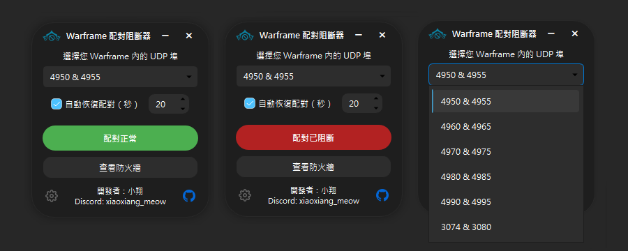
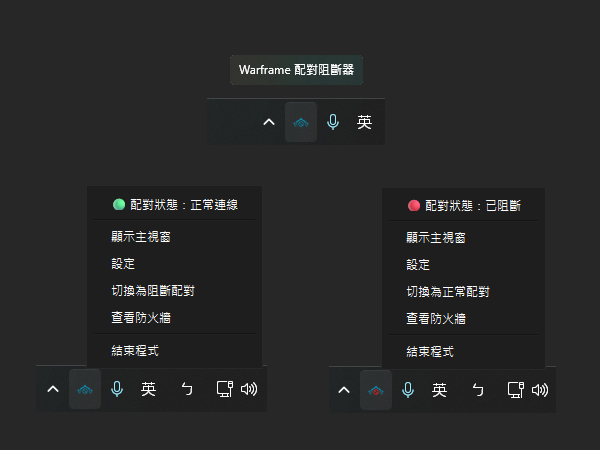
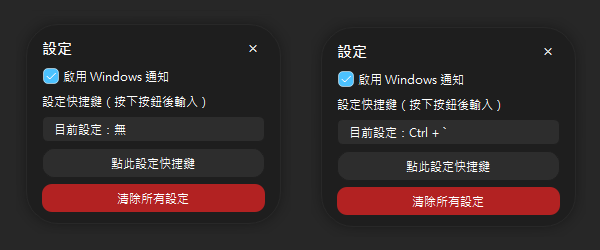
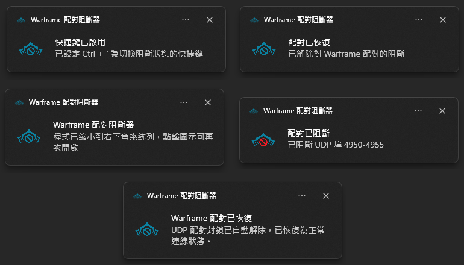

# **Warframe 配對阻斷器**

  

透過暫時阻斷特定 UDP 埠的輸出，避免加入其他玩家的主機。不過最後是不是主機，還是由遊戲決定，沒辦法保證每次都成功。

> 若你想要在開放世界成為主機，你只要先將隊伍調整成非公開，進入載入的期間調整成公開即可，不必依賴此工具。

## **下載**

[**Windows 執行檔 點我下載**](https://github.com/MeowXiaoXiang/WarframePairBlockTool/releases/download/v3.1.0/WarframePairBlockTool.exe "下載 v3.1.0 版本")

## **功能特色**

- **PySide6 介面**：提供主視窗、設定面板與系統匣選單
- **系統匣支援**：關閉主視窗後仍在右下角系統匣執行，可隨時重新開啟
- **快捷鍵支援**：可設定全域快捷鍵快速切換阻斷狀態
- **UDP 埠選擇**：提供六組預設配對，每次只封鎖所選的兩個埠
- **自動解除阻斷**：預設 20 秒後解除阻斷，避免長時間阻斷影響 P2P 連線的穩定性
- **自動請求系統管理員權限**：工具啟動時會自動請求系統管理員權限，以便修改防火牆規則
- **主題適應**：自動適應 Windows 10/11 的明亮/深色主題設定
- **不進行遊戲注入**：本工具僅通過控制 Windows 防火牆來達成目的，不會對遊戲進行任何注入操作

## **v3.1.0 版本更新**

- 核對防火牆規則是否生效，六組選項都只封鎖所選兩埠
- 啟動與退出時清理本工具的封鎖，狀態不明時可重新檢查
- 檢查期間可預約一次阻斷或解除，完成檢查後執行
- 修正切換 Windows 明暗主題後的元件顏色與圖示顯示
- 改善設定還原與快捷鍵捕捉，支援 Esc 取消及 15 秒逾時
- 再次啟動時喚出既有視窗，並加入可選的 DEBUG 日誌
- 更新 Python 3.14 相容依賴與打包設定

完整更新內容與歷史版本請見 [變更紀錄](CHANGELOG.md)。

## **如何使用**

1. **啟動工具**：

   - 雙擊 `WarframePairBlockTool.exe` 就能啟動，工具會請求系統管理員權限，用來修改防火牆規則。
   - 啟動時會先解除本工具上次留下的封鎖。
2. **開始阻斷配對**：

   - 先選好遊戲內使用的 UDP 埠配對，例如 4950 和 4955，記得兩邊要一樣。
   - 點擊「**配對正常**」按鈕；確認所選兩埠的封鎖生效後，按鈕會變為「**配對已阻斷**」。再次點擊即可解除。
   - 看到「**重新檢查**」時，表示目前無法確認封鎖狀態，按一下讓工具再確認就好。
3. **自動解除阻斷**：

   - 確認封鎖建立後開始倒數，預設 20 秒後執行解除。想調整時間的話，可以直接改秒數，也可以關閉「自動恢復配對」。
4. **右下角系統匣操作**：

   - 關閉主視窗會隱藏至系統匣；最小化按鈕則會最小化至工作列。
   - 在右下角系統匣圖示上按右鍵，可以重新開啟主視窗或切換阻斷。想真正關掉程式的話，選「結束程式」就好。
   - 結束前會先解除封鎖；若清理失敗，可重試或取消退出。選擇「仍要退出」可能留下封鎖。

## **打包說明**

1. **安裝依賴套件**：使用 Python 3.14，在專案根目錄的 PowerShell 執行：

   ```powershell
   python -m venv .venv
   .\.venv\Scripts\python.exe -m pip install -r requirements.txt
   ```

2. **打包程式**：在專案根目錄下輸入以下指令：

   ```powershell
   .\.venv\Scripts\python.exe -m pip install pyinstaller==6.22.3
   .\.venv\Scripts\python.exe -m PyInstaller build.spec --noconfirm --clean
   ```

3. **查看打包結果**：
   打包完成後，執行檔位於 `dist/WarframePairBlockTool.exe`。

若要直接執行原始碼，可使用：

```powershell
.\.venv\Scripts\python.exe main.py
```

## **使用介面示意圖**

以下圖片為舊版介面示意，部分按鈕文字與狀態顯示已在 v3.1.0 調整。

### 主介面展示



圖中依序展示未阻斷、已阻斷與展開 UDP 埠選單的畫面：

- **左側**：正常狀態，按鈕為綠色，代表目前未進行封鎖
- **中間**：阻斷狀態，按鈕變為紅色，表示目前封鎖中
- **右側**：展開 UDP 埠下拉選單以選擇遊戲內使用的埠配對

---

### 系統匣功能與狀態顯示



透過系統匣圖示，你可以快速執行：

- 顯示主視窗
- 切換阻斷狀態
- 查看封鎖狀態：綠點表示已解除、紅點表示已封鎖，白點表示檢查中或無法確認
- 一鍵開啟 Windows 防火牆管理介面

---

### 設定面板



你可以在這裡設定快捷鍵與 Windows 通知：

- **左側**：未設定任何快捷鍵，僅啟用 Windows 通知功能
- **右側**：已設定快捷鍵（如 `Alt + A`），可用於快速切換阻斷狀態
- 設定快捷鍵時可按 Esc 取消；15 秒內未完成也會取消，保留原快捷鍵
- 「**還原預設設定**」會先解除封鎖，再還原 UDP 埠、自動恢復及通知設定，並移除快捷鍵；清理失敗時保留原設定

---

### 通知效果展示



啟用「顯示 Windows 通知」後，工具會在以下狀況嘗試顯示通知：

- 主視窗隱藏至系統匣
- 使用快捷鍵阻斷配對（顯示封鎖的 UDP 埠）
- 使用快捷鍵解除阻斷

> 注意：通知顯示效果將受 Windows 系統設定影響。

## **常見問題與注意事項**

1. **無法成為主機？**

   - 檢查防火牆是否有名為「WarframePairBlockPort」的輸出封鎖規則
   - 確保工具中選擇的 UDP 埠與遊戲內設定相符（可在 Warframe 的「選項 → 系統 → 網路連接埠 [UDP]」查看）
   - 確認你的系統允許遊戲的 P2P 連線
2. **阻斷後看不到其他玩家？**

   - 過長的阻斷時間可能導致同步問題。
   - 可縮短阻斷時間，並啟用「**自動恢復配對**」，避免忘記解除。
3. **防毒軟體阻擋執行檔？**

   - 先確認下載來源與警告內容，也可比對發布頁提供的 SHA-256 校驗值；不要直接將未確認的檔案加入信任清單。
4. **找不到右下角系統匣圖示？**

   - 檢查 Windows 工作列右下角的隱藏圖示區域。
   - 確保程式已啟動且未被系統終止。

5. **設定檔和日誌在哪裡？**

   - 在檔案總管位址列輸入 `%APPDATA%\WarframePairBlockTool` 即可開啟。
   - 設定檔為 `WarframePairBlockTool.ini`，日誌為 `WarframePairBlockTool.log`。
   - 排查問題時可使用 `WarframePairBlockTool.exe --debug`（或 `-debug`）啟動，記錄更詳細的日誌。

## **問題回報**

遇到問題，或有什麼想法，歡迎到 [GitHub Issues](https://github.com/MeowXiaoXiang/WarframePairBlockTool/issues) 跟我說。
